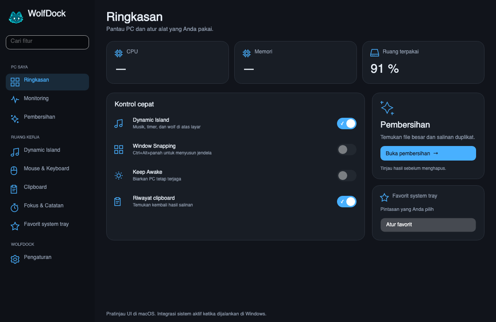
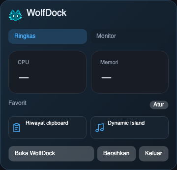

# WolfDock

WolfDock is the new name for MacDock. One Mac utility for Dock previews, window snapping, audio, clipboard, cleanup, mouse profiles and live monitoring, with an interactive blue wolf in Dynamic Island. A separate Windows preview brings the same visual direction and an initial set of desktop tools.

This public repository contains downloads and release notes. Application source development remains private.

## Downloads

| Platform | Download | Requirements |
| --- | --- | --- |
| macOS | [WolfDock 1.6.12](https://github.com/sSegara/MacDock-Releases/releases/tag/v1.6.12) | Apple silicon, macOS 26 or later |
| Windows preview | [WolfDock 0.1.1 for Windows](https://github.com/sSegara/MacDock-Releases/releases/tag/windows-v0.1.1) | Windows 10 22H2 / Windows 11, x64 |

[Latest stable Mac release](https://github.com/sSegara/MacDock-Releases/releases/latest) · [All releases](https://github.com/sSegara/MacDock-Releases/releases)

## Mac

The 1.6.12 update keeps Clipboard image previews stable through gallery refreshes, replaces Health with Reminders and removes water-volume logging. Water reminders keep configurable intervals during 08:00–22:00. The successful playback notice, weather explanation/provider footer and duplicate Keep Awake row have been removed. Keep Awake remains available through Favorites. Profiles and feature choices remain preserved through the signed update.

For a new installation, download **WolfDock-1.6.12.dmg** and copy WolfDock into Applications. Existing MacDock/WolfDock installations can choose **Check for updates → Update** in the app. Feature choices, mouse profiles and automation profiles stay in the existing settings domain. Release checksums and the original MacDock signing identity are verified before replacement.

The **MacDock-1.6.12.dmg** asset provides compatibility with older app names and updaters. Both DMGs contain the same signed app bytes. For manual replacement, choose the package matching the name already installed in Applications. Users of 1.6.3/1.6.4 need this manual replacement once, because those versions have an older update helper; versions from 1.6.5 use the corrected helper.

Mac builds are locally signed and are not notarized. macOS may require **System Settings → Privacy & Security → Open Anyway** on the first launch. Later updates retain the original signing identity. Automatic update checks can be disabled in the Updates page; installation begins only after choosing Update.

## Windows preview

Extract **WolfDock-Windows-0.1.1-x64.zip** and run **WolfDock.exe**. The .NET runtime is included; administrator access is not requested. Closing the main window keeps WolfDock in the system tray. Click the wolf for the blue quick panel with CPU/RAM and favorites; choose **Buka WolfDock** to restore the main window. Right-click retains the native menu. To update an older preview, exit it through its tray menu before launching the new version; the saved profile is retained.

Included: live CPU/RAM and volume usage, Keep Awake, keyboard window snapping, music/video Dynamic Island, countdown, notes, local clipboard history, tray favorites, folder analysis and reviewed duplicate cleanup through Recycle Bin. Settings are stored separately at `%LOCALAPPDATA%\WolfDock\settings.json`.

The 0.1.1 update also removes repeated interface text, restores minimized windows and saves pending note edits before searching.

This is an early preview: 314 source/headless checks pass, including 36 page/size combinations, but native Windows integrations still need testing on a Windows PC. The executable is not Authenticode signed. Windows automatic updates, per-device mouse profiles, temperature/SMART sensors, disk benchmarking, lyrics/weather and other Mac-only tools are still pending. The release notes list the current limits.

## Checksums

Each download includes a SHA-256 checksum file. Verify the downloaded ZIP or DMG against its matching checksum before manual installation.
